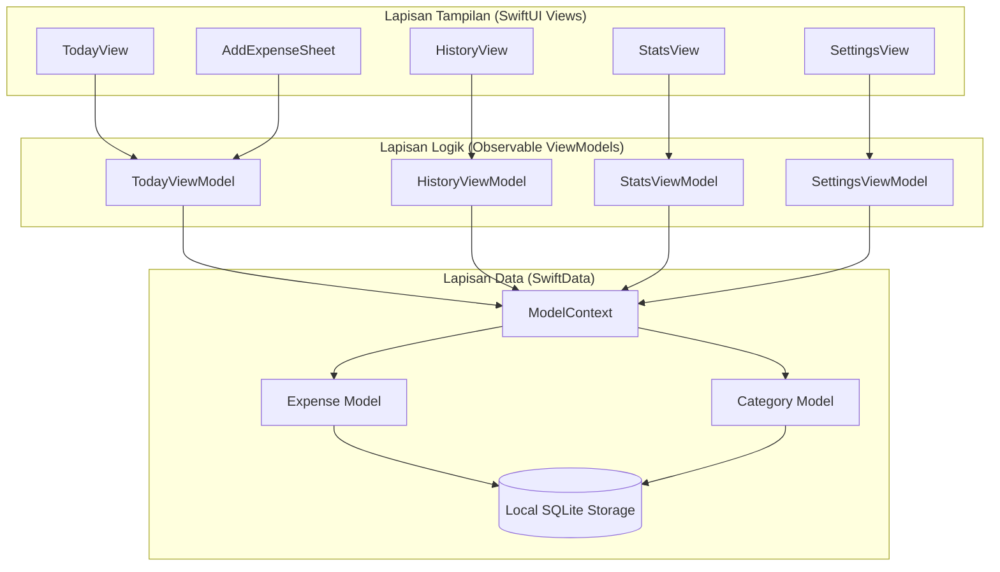
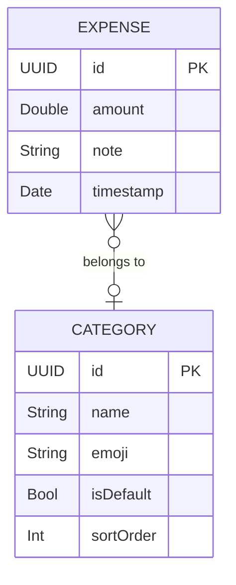
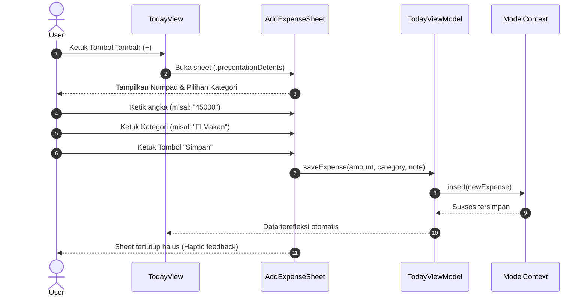

# Design Specification: SimpleNote Core Tracker

## 1. Arsitektur Sistem

SimpleNote dibangun di atas pola arsitektur **MVVM (Model-View-ViewModel)** modern dengan deklarasi reaktif murni menggunakan framework SwiftUI dan SwiftData di iOS 17+.



## 2. Model Data & Skema SwiftData

### 2.1. Entitas Expense
```swift
@Model
final class Expense {
    @Attribute(.unique) var id: UUID
    var amount: Double
    var note: String
    var timestamp: Date
    var category: Category?

    init(amount: Double, note: String = "", timestamp: Date = .now, category: Category? = nil) {
        self.id = UUID()
        self.amount = amount
        self.note = note
        self.timestamp = timestamp
        self.category = category
    }
}
```

### 2.2. Entitas Category
```swift
@Model
final class Category {
    @Attribute(.unique) var id: UUID
    var name: String
    var emoji: String
    var isDefault: Bool
    var sortOrder: Int

    @Relationship(deleteRule: .nullify, inverse: \Expense.category)
    var expenses: [Expense]

    init(name: String, emoji: String, isDefault: Bool = false, sortOrder: Int = 0) {
        self.id = UUID()
        self.name = name
        self.emoji = emoji
        self.isDefault = isDefault
        self.sortOrder = sortOrder
        self.expenses = []
    }
}
```

### 2.3. Diagram Relasi Entitas (ERD)


## 3. Sequence Alur Pencatatan (Zero-Friction Fast Add)



## 4. Design System & Tokens (Calm & Focused)

### 4.1. Color Palette Tokens
- **`Color.snGround`** (`#F9F7F4` / Dark: `#121212`): Warna dasar latar belakang yang hangat, seperti kertas jurnal halus.
- **`Color.snSurface`** (`#FFFFFF` / Dark: `#1E1E1E`): Warna kartu dan elemen yang dapat disentuh.
- **`Color.snInk`** (`#1A1A1A` / Dark: `#F0F0F0`): Warna teks primer dengan kontras tinggi namun lembut.
- **`Color.snInkSecondary`** (`#6B6560` / Dark: `#A0A0A0`): Keterangan waktu, label, dan placeholder.
- **`Color.snAccent`** (`#2D6A4F` / Dark: `#52B788`): Sage green elegan untuk status aktif, tombol simpan, dan dot kalender.
- **`Color.snAccentSoft`** (`#D8F3DC` / Dark: `#1B4332`): Latar belakang chip kategori yang sedang dipilih.
- **`Color.snBorder`** (`#E8E4DF` / Dark: `#2C2C2C`): Garis pembatas tipis penegas struktur.

### 4.2. Typography Rules
- **Display Amount:** SF Pro Rounded, Bold, 34pt - 44pt (angka terasa ramah dan bersahabat).
- **Section Headers:** SF Pro Text, Semibold, 17pt.
- **List Items & Notes:** SF Pro Text, Regular, 15pt.
- **Subtext / Timestamps:** SF Pro Text, Regular, 13pt.
